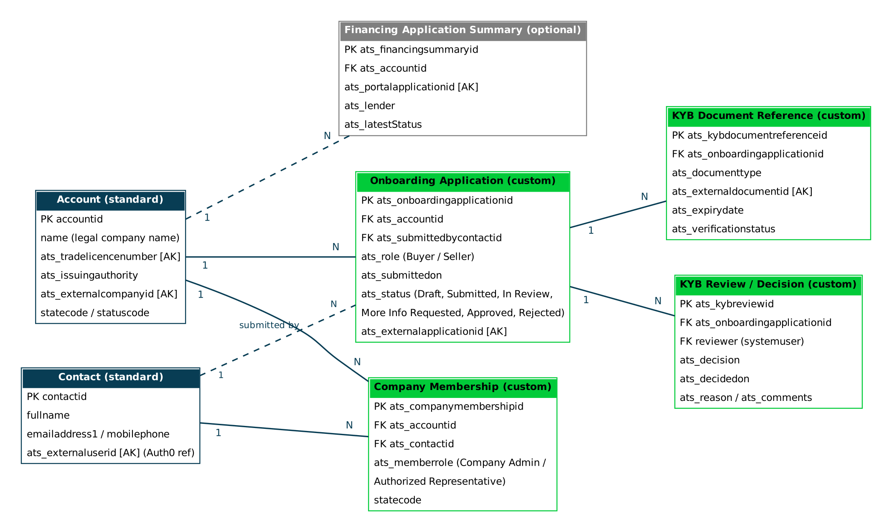
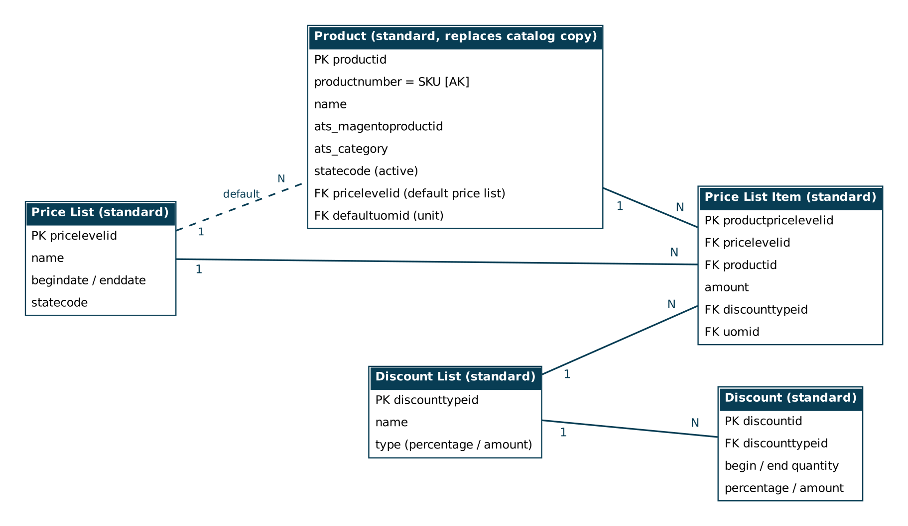
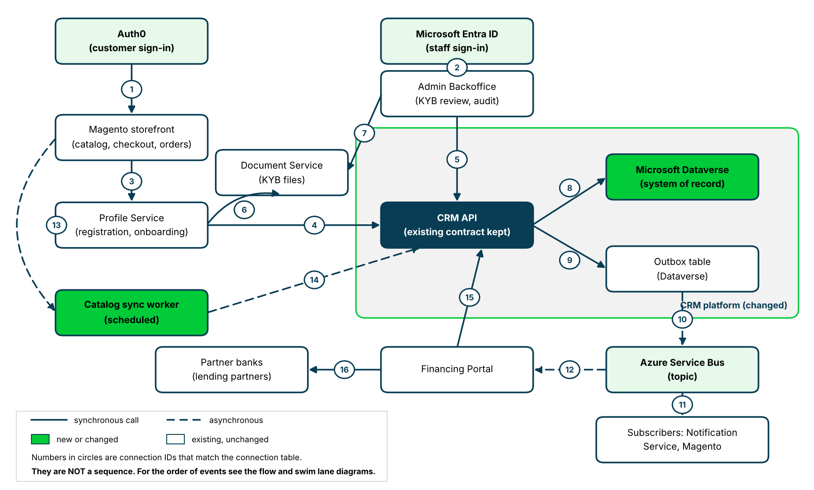
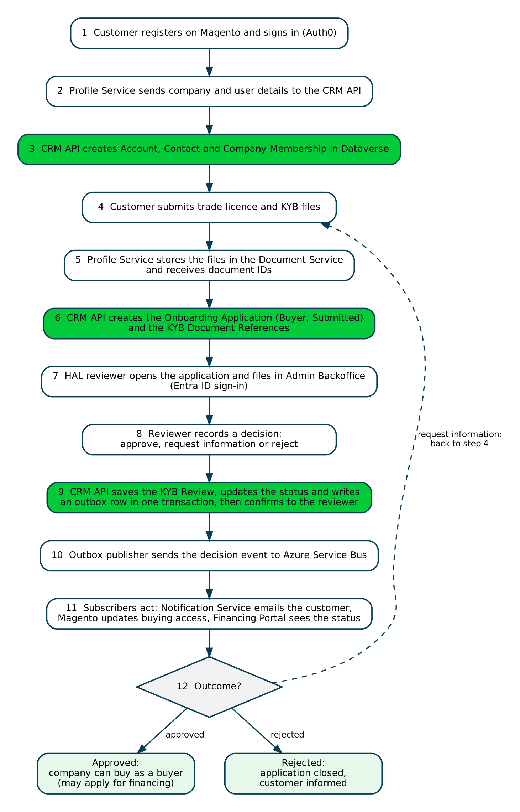

# HAL Dataverse Data Model and Integration Design

Prepared by Saim Asim, About The Solution (ATS), November 2026.

This repository contains a Dataverse entity model and an integration architecture for HAL, covering company onboarding, KYB approval, and catalog pricing by SKU. Key assumptions are listed below.

## What is in the design

1. **Dataverse entity model.** Standard Account, Contact and Product tables, plus custom tables prefixed `ats_` for company membership, onboarding applications (buyer and seller, independent), KYB document references and KYB reviews.
2. **Catalog and pricing.** Standard Product with the default price list and discount lists. The product SKU is held in `productnumber` and used as an alternate key, so Magento and Dataverse integrate by SKU.
3. **Integration architecture.** A CRM API facade in front of Dataverse (Web API, OData v4 over HTTPS). Auth0 for customers and Entra ID for staff. Azure Service Bus (AMQP 1.0 over TLS) for asynchronous events, with a transactional outbox and idempotent subscribers.
4. **Onboarding and approval flow.** A 12-step flow from sign-up to decision.

## Diagrams

### 1. Entity relationship diagrams (ERD)

The Dataverse data model is split into two diagrams. All custom tables use the `ats_` prefix. In the diagrams, PK is a primary key, FK is a foreign key and AK is an alternate key (a business key used for matching and synchronization instead of the GUID).

**ERD 1: company onboarding and KYB** (`diagrams/ERD_Company_Onboarding.png`)

- **Account** (standard) is the company, one row per legal entity, matched by trade licence number.
- **Contact** (standard) is the person. It stores only the external Auth0 user reference, not login details.
- **Company Membership** (custom) links a person to a company with a role, so one person can act for several companies.
- **Onboarding Application** (custom) is the buyer or seller application. Buyer and seller approvals are independent, each with its own status (Draft, Submitted, In Review, More Info Requested, Approved, Rejected).
- **KYB Document Reference** (custom) points to a file held in the Document Service. Only the reference, type, expiry and verification status are stored in Dataverse.
- **KYB Review / Decision** (custom) records the reviewer, decision, date and reason, which gives a full audit trail.
- **Financing Application Summary** (optional) gives CRM staff visibility of financing status. The full application stays in the Financing Portal.

**ERD 2: product, price list and discounts** (`diagrams/ERD_Product_Pricing.png`)

- **Product** (standard) holds the catalog item. The SKU is stored in Product Number, which is an alternate key, so Magento and Dataverse are matched by SKU without GUID lookups.
- **Price List** (standard) is the default price list, and **Price List Item** holds the unit price for each product.
- **Discount List** and **Discount** (standard) hold discount terms on top of the default price.
- Magento owns the catalog. A scheduled sync worker upserts each product into Dataverse by SKU, so it is safe to re-run and creates no duplicates.

### 2. Integration architecture

`diagrams/Integration_Architecture_V3.png`

The CRM API is a facade in front of Dataverse. It is the only service that talks to Dataverse, through the Dataverse Web API (OData v4 over HTTPS). Use a synchronous call when a person is waiting for the answer. Use an asynchronous event when the work can follow after the response.

- **Sign-in:** customers use Auth0 and staff use Entra ID. Each service validates the token it receives.
- **Onboarding:** Magento calls the Profile Service, which calls the CRM API. Files go to the Document Service and only the document ID is kept in Dataverse.
- **Review:** Admin Backoffice reads the queue and records decisions through the CRM API.
- **Events:** the decision and an outbox row are saved together. A publisher sends the event to Azure Service Bus (AMQP 1.0 over TLS), and subscribers such as the Notification Service, Magento and the Financing Portal receive it independently. Delivery is at least once, so subscribers ignore duplicates.
- **Catalog:** a scheduled worker reads products from Magento and upserts them into Dataverse by SKU.

The numbers on the diagram are connection IDs that match the table below. They are not a sequence of steps. The table lists only the connections that involve the CRM API, Dataverse, the event bus and the catalog sync. Connections 1, 2, 3, 6, 7 and 16 are between existing systems (sign-in, Profile Service, Document Service and the partner bank). They are shown on the diagram for context and are outside this design.

| ID | Connection | Data exchanged | Protocol | Interaction |
|---|---|---|---|---|
| 4 | Profile Service to CRM API | Create or update user and company, submit onboarding, read status | HTTPS REST (JSON) | Synchronous |
| 5 | Admin Backoffice to CRM API | Review queue, approval or rejection, decision history | HTTPS REST (JSON) | Synchronous |
| 8 | CRM API to Dataverse | Company, contact, membership, application and KYB records | Dataverse Web API, OData v4 over HTTPS | Synchronous |
| 9 | CRM API to Outbox table | Event row written in the same transaction as the decision | Dataverse Web API (single changeset) | Synchronous |
| 10 | Outbox publisher to Azure Service Bus | CompanyOnboardingApproved with company ID, application ID and buyer or seller role | AMQP 1.0 over TLS, topic | Asynchronous, event driven |
| 11 | Service Bus to subscribers | Event delivered to Notification Service and Magento | Topic subscriptions | Asynchronous, event driven |
| 12 | Service Bus to Financing Portal | Company approved event | Topic subscription | Asynchronous, event driven |
| 13 | Magento to catalog sync worker | Product ID, SKU, name, category, active status, price and discount | Magento HTTPS REST API (to be confirmed) | Scheduled batch |
| 14 | Catalog sync worker to CRM API | Upsert of Product by SKU, with its default price list item and discount list | HTTPS REST (JSON) | Asynchronous, scheduled |
| 15 | Financing Portal to CRM API | Company and approval status lookup; optional financing summary push | HTTPS REST (JSON) | Synchronous |

### 3. Onboarding and approval flowchart

`diagrams/Onboarding_Flow.png`

This flow shows the order of events from registration to the approval decision. Step numbers here are a sequence, unlike the connection IDs on the integration diagram. A request for more information loops the applicant back to upload more documents and resubmit.

1. Customer registers on Magento and signs in with Auth0. Magento passes the registration to the Profile Service (connection 3).
2. The Profile Service sends the company and user details to the CRM API (connection 4).
3. The CRM API creates the Account, Contact and Company Membership in Dataverse (connection 8).
4. The customer submits the trade licence and other KYB files through the Profile Service.
5. The Profile Service stores each file in the Document Service and receives a document ID (connection 6).
6. The CRM API creates the Onboarding Application (role Buyer, status Submitted) and a KYB Document Reference for each document ID.
7. A HAL reviewer signs in with Entra ID, opens the application in Admin Backoffice and views the files (connections 5 and 7).
8. The reviewer records a decision: approve, request information or reject.
9. The CRM API saves the KYB Review, updates the application status and writes an outbox row in one transaction, then confirms to the reviewer (connection 9).
10. The outbox publisher sends the decision event to Azure Service Bus (connection 10).
11. Subscribers act on the event: the Notification Service emails the customer, Magento updates buying access and the Financing Portal sees the new status (connections 11 and 12).
12. Outcome: if approved, the company can buy as a buyer and may apply for financing. If rejected, the application is closed and the customer is informed. If more information was requested, the customer resubmits and the flow returns to step 4.

## Assumptions

Made where the brief is silent. Each states what changes if it is wrong, and should be confirmed with HAL before implementation.

| ID | Topic | Assumption | Impact if wrong |
|---|---|---|---|
| A1 | Design only | The deliverable is two designs (entity design and integration architecture) in a GitHub repository. A working implementation of the platform is not required. | Scope would need to be extended to build and test effort. |
| A2 | Dataverse as system of record | Dataverse is authoritative for company, contact, membership, onboarding application and KYB data. The CRM API remains the only service that talks to Dataverse. | Services calling Dataverse directly would bypass the mapping layer and security model. |
| A3 | Existing CRM API contracts | The existing CRM API contracts were not provided. The design assumes they are preserved and that the CRM API maps them to Dataverse. | Mapping effort and any contract changes must be reassessed once the contracts are reviewed. |
| A4 | Company and roles | One Account represents one legal entity, identified by trade licence number. Buyer and seller approvals are independent: each is a separate Onboarding Application against the same Account. | If approvals were a single combined step, the Onboarding Application would collapse to one record per company. |
| A5 | People and companies | A Contact can represent more than one company through Company Membership. If HAL does not allow this, the design still works with a single membership per contact. | Constrain with a business rule only; no model change needed. |
| A6 | Documents | KYB files stay in the Document Service. Dataverse stores only the document reference, type, expiry and verification status. | Storing files in Dataverse would raise storage cost and change the upload flow. |
| A7 | Identity | Auth0 owns customer login identity and Entra ID owns staff sign-in. The Dataverse Contact is the business profile and holds only the external Auth0 user reference. Reviewers map to Dataverse system users. | A different identity provider changes the stored reference, not the model. |
| A8 | Catalog and pricing | Magento owns the product catalog. Dataverse uses the standard Product table with the default price list and Discount Lists, and each Magento product is matched to its Dataverse Product by SKU (Product Number alternate key). Sync is one-way from Magento (assumed). | If Dataverse must own price or discount values, the sync direction and conflict rules change. |
| A9 | Financing | The Financing Portal and partner banks own the full application, underwriting and credit decision. The Financing Application Summary table is optional and added only if HAL staff need financing visibility in CRM. | Without the summary, financing data is viewed in the Financing Portal only. |
| A10 | Eventing | Azure Service Bus is used with a topic and subscriptions. Events are published after the decision is saved, using an outbox for reliable delivery. Delivery is at least once, so consumers are idempotent. | Direct publishing after save risks lost events if the publish fails. |
| A11 | Proposed protocols | Protocols for the Magento catalog sync, Document Service, and Financing Portal to partner bank links are proposals. The actual protocols were not specified and must be confirmed. | Interfaces to those systems may change; the diagram shows the intended pattern. |
| A12 | Notifications | The reviewer gets confirmation when the decision is saved. Customer notification is separate and is triggered by the event through Service Bus. | Customer messages delayed or failed do not affect the decision record. |
| A13 | Migration | Existing CRM records are migrated into Dataverse. Existing external IDs are kept as alternate keys so incoming records can be matched during migration and synchronization. This applies where the IDs are stable and unique. | Unstable IDs require a cross-reference table or match rules. |
| A14 | Naming and platform | A single custom publisher prefix (ats_) is used. The standard Product, Price List and Discount List tables are available in the environment (confirm Dynamics 365 Sales licensing). | A different prefix or app set changes naming only. |

## How to view

Open the PNG images in the `diagrams/` folder directly on GitHub.
